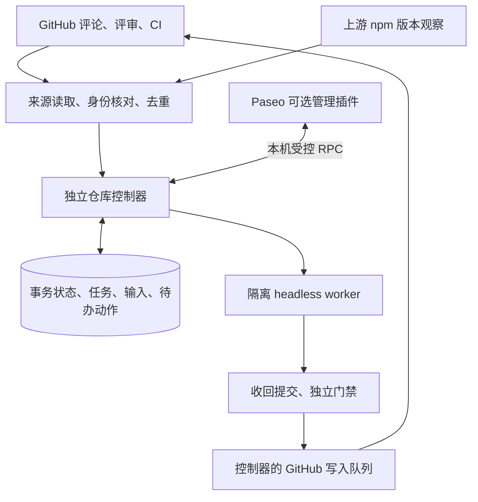

# 决策记录: 用独立控制器为本仓库持续接单和跟进 PR

Status: proposed

> 本文是 agent 单方面形成、未经用户认可的调研草稿，不代表双方已经选择实施路线。文中的阶段、验收指标与人日估算不作为实施依据。后续讨论明确的目标是减少用户记住、发起和跟进 GitHub issue 与 DSH/Paseo 上游检查的杂活；AI 工作投入按 token 消耗评估。用户允许符合项目开发目标、不恶意改变项目服务内容的维护工作自主推进，并要求充分 simplify 和验证；正式发布前须主动提供可审查的变更说明，经用户明确同意后才发布或合并触发发布，未回复时保持待发布。本文原先自行拟定的阶段性发布限制不作为双方约定，实际发布遵循此确认要求。技术调研仍须按实际版本复核。

## 问题

**源码与测试支持本仓库开展 superagent 试点，优先解决持续维护本仓库；真实全链路尚未验收。推荐由独立、可恢复的仓库控制器管理工作，保留隔离执行器。P0 先验证 Paseo Hub 能否承担这层职责；满足要求就复用 Hub，否则演进现有 GitHub agent-loop。对外能力另设可选管理插件，不把上游 bundle 加进普通 `paseo` profile。**

交付顺序为：P0 选择控制器实现，P1 补可靠性，P2 跑新版本兼容性检查，P3 跑通 PR 跟进；这四步组成第一阶段的仓库维护闭环。第二阶段才做 Paseo 管理界面，第三阶段再评估原生任务会话。下文先列证据，再给具体设计和验收条件。

这里的 superagent 指：长期接收仓库事件，按明确授权决定是否开工，为一项工作保存任务、执行记录和讨论订阅，在 PR 评审、CI 变化或人工答复后继续，直到交付或停止。DSH 的 goal 与 subagent 可以帮助执行一项任务，但不能替代这层仓库任务管理。

本提案同时评估两个目标，并按依赖安排先后：

| 目标 | 可行性 | 本提案的建议 |
|---|---|---|
| 用 superagent 维护 `paseo-dsh-direct` | 已有 GitHub 入口、隔离执行、会话续接和交付代码，适合试点；缺完整恢复验收 | 第一阶段落地，主要改变开发工具 |
| 让安装本插件的用户在 Paseo 中使用仓库 superagent | 可行，但现有 Provider 没有仓库级常驻生命周期与任务契约 | 先验证控制器，再开发可选 companion 插件；普通 Provider 保持职责 |

第二个目标包含产品、协议和运行时依赖的方向性变化，所以方案记录在 architecture。第一阶段的代码属于仓库维护工具，不随当前 npm 插件发布。

### 调研基线与证据边界

调研日期为 2026-11-01（Asia/Shanghai）：

- 本仓库：`3800739edd505a25d0e3a37ba92cf05a51d50744`，插件 `0.2.15`，开发 SDK `@getpaseo/plugin 0.14.0`，清单最低 Paseo `>=0.11.0`。
- 上游：[`deepseek-ai/dsh-superagent-prototype` 固定提交 `6337fc8`](https://github.com/deepseek-ai/dsh-superagent-prototype/tree/6337fc823ce20251c8de8085948165c81aaa701e)。它在 README 中明确为研究原型，且与团队内部版本及文章描述不完全相同。
- 本机：Node `v24.22.0`，`dsh 0.2.1-rc.4`。上游声明的 Node 范围为 `^22.19.0 || >=24.0.0`，DSH 为 `^0.2.1-alpha.2`。满足范围不能证明 rc.4 上已完成真实运行时验收。
- 在 `/tmp/dsh-superagent-research-20261101` 独立 clone 上执行 `pnpm install --frozen-lockfile --ignore-scripts`；类型检查与构建通过。59 个测试文件中 58 个通过，1197 项中 1196 项通过。唯一失败是飞书事件消费者的错误健康状态断言；单独重跑仍失败。
- 该失败对应上游 `tests/sources.spec.ts:1089`：接收非法 JSON 后预期保留 error，实际为 ready。`src/sources/feishu-loops.ts:79-96` 分别处理 stderr 就绪消息与 stdout 错误，两条流的到达顺序可能使 ready 覆盖错误。这是代码和测试支持的解释，尚未做线上飞书验证。
- 本仓保留的 `core.test.ts` 与 `app-auth.test.ts` 共 64 项测试通过。没有在本轮启动新机器人、变更服务、向 GitHub 或飞书发消息、推送或部署。
- 只读主机检查显示 `paseo-dsh-direct-agent.service` 为 active/running，但其独立服务 clone HEAD 为 `9e07916`，与本仓 HEAD 不同。运行状态不能证明当前源码已部署，也不能证明服务完整健康。仓库提交 [`9f58b7b`](https://github.com/Jecvay/paseo-dsh-direct/commit/9f58b7bc175d27d964b878e6e933c0b892b9e59e) 记录过停用及删除操作文档；需要重新核对部署记录。

以下“已有”指当前仓库源码，运行态另行说明。判断主要依据源码、测试和公开文档，未做真实 GitHub 到模型再到 PR 的全链路演练。

### 上游已经实现什么

上游的关键价值在任务管理、授权和恢复。详见其[领域模型](https://github.com/deepseek-ai/dsh-superagent-prototype/blob/6337fc823ce20251c8de8085948165c81aaa701e/docs/001-domain.md)、[执行机制](https://github.com/deepseek-ai/dsh-superagent-prototype/blob/6337fc823ce20251c8de8085948165c81aaa701e/docs/003-execution.md)与[架构](https://github.com/deepseek-ai/dsh-superagent-prototype/blob/6337fc823ce20251c8de8085948165c81aaa701e/docs/007-architecture.md)。

| 已实现的机制 | 对本仓的用途 | 采用时需要注意 |
|---|---|---|
| Source → Trigger → Eval → Ticket → Assignment | 区分外部事件、一项长期工作、某一次执行，避免把进程退出当任务完成 | 本仓试点只需 GitHub，不必一次引入飞书及完整可配置来源系统 |
| 确定性准入 + 模型评估 + Mandate | 代码先核对谁能请求工作，再让模型判断意图，并记录允许做什么 | 自然语言 scope 仍需模型遵守，不能据此宣称 shell 或 git 已强制限制业务范围 |
| `off / observe / auto` | 先记录“本会开工”，再按实际误报决定是否自动执行 | `observe` 只限制 inferred 候选；explicit 请求仍会执行，不等于所有行为只读 |
| Thread 订阅与 PR/CI 跟进 | 原任务收到后续评审和检查结果，可以继续工作 | 上游订阅绕过新任务准入；任何人的跟帖都可成为上下文，部分跟帖可唤醒已结束任务，需要收紧 |
| SQLite 事务 + Effects + Outbox | 先保存状态和待办动作，重启后继续投递、恢复执行和回传结果 | 不等于任意外部动作 exactly-once；GitHub 评论另有隐藏标记查询去重，worker shell 动作仍需核对 |
| 主 Session 只路由、worker 只执行 | 路由不会被长命令阻塞，任务相互隔离上下文 | 不要求本仓为每个明确命令先调用一次模型 |
| 有限 worker slots、后台任务感知、人工输入优先 | 控制并发，后台任务未完不会被误判空闲 | 上游默认 3 个 worker，人工消息可使用额外一个 slot；本机建议从 1 开始 |
| `human_action`、结构化报告、需要人工处理的面板 | 把问题、结果和失败直接放到维护者面前 | 上游 worker 没有普通 `ask_user_question`/goal/workflow；人工问答走任务报告体系 |
| prompt 与 policy 的版本记录 | 能查明某次决策采用了哪些规则 | 规则变化只通知受影响的运行中任务，不会立即停止它们 |

上游不是一个可直接给 Paseo 导入的 npm 库：包为 `private: true`，作为 DSH bundle 分发；主入口还会加载完整 DSH 依赖。[包定义](https://github.com/deepseek-ai/dsh-superagent-prototype/blob/6337fc823ce20251c8de8085948165c81aaa701e/package.json)、[入口](https://github.com/deepseek-ai/dsh-superagent-prototype/blob/6337fc823ce20251c8de8085948165c81aaa701e/src/index.ts)和[部署说明](https://github.com/deepseek-ai/dsh-superagent-prototype/blob/6337fc823ce20251c8de8085948165c81aaa701e/docs/006-deployment.md)比 README 中的功能描述更能说明接入成本。

### 本仓可以复用什么，缺什么

| 现有基础 | 源码证据 | 距离持续任务管理的缺口 |
|---|---|---|
| owner 的 `/jecbot`、`agent:go`、看板开工入口；防机器人自触发 | [core.ts](../../../../scripts/agent-loop/core.ts)，`isOwnerInstruction`、`scanComments`、`scanEvents`、`scanBoard` | 只处理这几类明确开工信号，没有订阅 PR 生命周期与自动反馈的任务模型 |
| JSON 状态、队列、线程到 session/branch 的映射、单实例锁 | [main.ts](../../../../scripts/agent-loop/main.ts)，`LoopState`、`saveState`、`acquireLock` | 原子 rename 解决单文件替换，不解决状态与 GitHub 写入之间的一致性；没有持久化外部动作队列 |
| 一个时刻执行一个任务，按插件版本线选择 dsh | [main.ts](../../../../scripts/agent-loop/main.ts)，`main`、`runTask`；[core.ts](../../../../scripts/agent-loop/core.ts)，版本选择函数 | WIP=1 是执行并发限制，待审任务不占执行位；没有成本预算、线程公平调度或人机输入优先级 |
| 固定线程路径、headless 会话续接、独立服务 clone | [main.ts](../../../../scripts/agent-loop/main.ts)，`runTask` | 没有重启自动恢复 Assignment；session id 要到子进程退出后才存入线程状态 |
| bubblewrap、隐藏凭证、独立 DSH_HOME、git bundle 收回提交、干净 clone 门禁、控制器推送 | [core.ts](../../../../scripts/agent-loop/core.ts)，`bwrapArgv`、`scrubEnv`；[main.ts](../../../../scripts/agent-loop/main.ts)，`collectCommits`、`runGates`、`pushBranch` | 应保留并验证；这是本仓比原型默认执行方式更适合当前主机的部分，不是需要被替换的障碍 |
| `.agent-out` 结果契约、门禁失败不推送、App 身份交付 | [gh-board skill](../../../skills/gh-board/SKILL.md)、[app-auth.ts](../../../../scripts/agent-loop/app-auth.ts) | 报告较粗；`blocked.md` 优先但没有任务级 Attention、输入确认与提交核对状态 |
| Direct Provider 的流式输出、审批、持久会话、goal 展示与安全停止 | [服务端架构](../../../../docs/server-architecture.md)、[客户端架构](../../../../docs/client-architecture.md) | 用于交互会话；现有 headless loop 不经过 Paseo，因此手机看不到其原生回合 |

必须先处理的现有可靠性问题：

1. `main.ts:765-768` 先从队列移出并保存 handled，再进入 `runTask`；`runTask:554` 读取 issue 后才在 565 行保存 running。读取失败或进程在这段之间退出，会留下“已处理”但没有可恢复执行记录的指令。
2. `poll:329-332` 读取 issue 失败后直接丢弃 Trigger，随后整体推进游标；临时读取失败不应永久丢任务。
3. 评论扫描只回看最近 24 小时；issue label events 只读一页 100 条。停机较久或事件密集时可能漏掉信号。恢复应从持久游标分页读，重叠窗口只用于去重，不作为唯一历史范围。
4. `recoverInterrupted` 只报告中断并等待人工重发。`runTask` 不持久化 push、PR create、comment 的完整进度，网络响应丢失或重启可能导致结果与本地状态不同。
5. `core.ts:385-399` 只把超时、非零退出和 `turnEnd === 'error'` 判为失败；有提交时，缺少终态、被中断或输出不完整仍可能进入推送路径。应按实际 DSH 版本识别明确的正常终态，并要求完整报告和候选 commit 的验收证据，不能只看进程退出码。`reply.md`、PR 标题缺失也不应静默用默认内容交付。
6. “15 分钟没有 git 改动就终止”不能可靠区分卡死与正常调查/测试；同步 `spawnSync` 的安装、GitHub 调用和门禁还会暂停主进程轮询。应改为异步、独立的执行阶段及有依据的总时限。

### 为什么不能直接把 bundle 装进当前 profile

| 接口或不变量 | 事实 | 直接加载的后果 |
|---|---|---|
| 当前一会话一进程，发现也起进程 | [provider.ts](../../../../server/provider.ts):146、508；设置读写也起独立桥 | 多个进程都尝试监听来源、锁定同一 stateDir；用不同 stateDir 又会重复接单 |
| 当前桥禁用 DSH web 服务 | [bridge-client.ts](../../../../server/bridge-client.ts):101、119；上游 `src/index.ts:8` 必需 `webServer` | 原型不能按原样激活；保留 web 服务又涉及端口、交互路由与资源的新约束 |
| 上游要求独立进程环境 | 上游 `src/infra/environment.ts:119-124` 修改 process PATH 与 git 环境；`Runtime` 独占 stateDir | 不适合在普通聊天 profile 的每次发现和设置请求中附带启动 |
| 当前桥只发 tracked 会话事件 | [service.ts](../../../../server/dsh/service.ts):170-186；[provider.ts](../../../../server/provider.ts):279 起按 nativeId 过滤 | 独立创建的 worker 不会自动变成 Paseo agent 或子会话；没有 tracked 祖先的审批也不会被这条桥接管 |
| DSH 会话只有一个 writer | [service.ts](../../../../server/dsh/service.ts):889 起使用官方 create/resume | 不能在 sidecar 正写 worker 时，再 Import 到另一个 DSH 进程继续写；只读观察与执行接管应分开 |
| 当前关闭桥会终止整个进程 | [bridge-client.ts](../../../../server/bridge-client.ts):524-540 仅给 shutdown 500ms，再有界终止 | 关闭普通会话或重载插件可能带走仓库监听器；原型的任务收尾需要自己的生命周期 |
| 空闲安全查询不认识新业务队列 | [runtime-safety.ts](../../../../server/dsh/runtime-safety.ts) 检查 agent、inbox、goal、schedule、jobs 和 subagent | 它不检查任意 Source timer、Effects/Outbox 等；“所有 agent 空闲”不能证明常驻控制器可关闭 |
| 当前 cwd 在 session.open 才给出 | [bridge-client.ts](../../../../server/bridge-client.ts) 的 SessionLaunch 无 cwd；[provider.ts](../../../../server/provider.ts):525 起传会话 cwd | profile 启动时不能靠 process.cwd() 确定监听哪个仓库 |
| 当前会话先 open、后装直播监听 | [provider.ts](../../../../server/provider.ts):525-564 | 自动启动任务可能在监听装好前发出 stream 或交互通知；需要先订阅/缓冲再明确激活 |
| 上游 worker 权限与前端属于其自身体系 | `Sessions.ensure` 强制 danger-full-access；前端使用 DOM、CSS 和 `window.__ModuleLoader__` | 不能照搬成移动端 Paseo UI，也不能承诺沿用普通 Paseo 会话所选权限 |

## 提案

### 采用独立控制器，先完成本仓维护闭环

第一阶段使用一个仓库控制器管理一个仓库，独立于普通 Provider 连接和聊天会话运行。若 P0 选择自建路线，先扩展 `scripts/agent-loop/`，逐步移入 `scripts/repo-agent/`，下表描述这一路线的代码分工；不把维护脚本放入当前 npm 插件的 `files`，不在 Daemon 插件加载时自动启用服务。

控制器负责事件、授权、队列、工作目录、输入、恢复和交付；DSH 负责模型执行和工具调用；Paseo Provider 负责交互会话和标准展示。三者各自持有的状态通过稳定标识关联。

建议的代码分工：

| 位置 | 责任 |
|---|---|
| `scripts/repo-agent/domain/` | Trigger、Task、Attempt、输入和状态转换；不读配置、不访问网络、不启动进程 |
| `scripts/repo-agent/store.ts` | 事务、schema migration、单实例锁、待办动作及回执 |
| `scripts/repo-agent/sources/github.ts` | 分页读取评论、review、check/commit status、PR merge/close；维护来源游标 |
| `scripts/repo-agent/policy.ts` | owner/allowlist、显式命令、rule version、允许的后续事件、暂停/停止 |
| `scripts/repo-agent/executors/headless.ts` | 现有 sandbox、按线选 dsh、会话恢复、流式记录 session id、结构化结果 |
| `scripts/repo-agent/delivery.ts` | 提交验收、head SHA 核对、幂等评论、push/PR 写入和重试 |
| `scripts/repo-agent/main.ts` | 生命周期、异步调度、启动对账、健康与退出 |

这些是计划新增路径，不是当前已提供的接口。不要在一次重构里同时增加飞书、通用多仓库、跨主机调度或自动发布。

### 借鉴领域模型，选择性移植代码

推荐采用上游的概念与不变量，先实现本仓需要的子集。保留明确的 `Source / Trigger / Task / Attempt / Policy / Subscription / Report`；Task 对应上游 Ticket，Attempt 对应 Assignment。可以沿用上游英文名减少对照成本，不必为了名字另建一套抽象。

不直接导入上游包的主入口，也不一开始复制整个 Engine、SQLite Store、模型路由及 UI。上游默认的跟帖权限、机器用户通知和 worker 直接交付方式都与本仓不同，完整 fork 的长期同步成本高。优先移植不依赖 DSH 运行时的 ID、状态计算和测试场景；每份移植代码保留 MIT 归属、上游提交和本地差异说明。若后续完整订阅语义确有必要，再决定提取或维护独立 core 包。

建议先用 SQLite 保存长期状态，承接上游“事务中登记动作，提交后执行”的机制。本机 Node 24 已有 `node:sqlite`；这只成为维护工具的运行要求。若对外分发控制器，须单独声明并验证 Node/DSH 组合，不把它隐含加到现有 Provider 下限。

最小持久模型应包括：

| 记录 | 至少保存什么 |
|---|---|
| Trigger | `repo/source/externalId/revision`、原始 actor、事件时间、内容摘要、归属 issue/PR/head SHA、是否允许执行 |
| Task | 请求者、来源、允许范围、policy revision、版本线、稳定目录与分支、已关联 PR、当前等待原因、停止记录 |
| Attempt | task id、递增执行序号、DSH executable/version、session id、起点 commit、启动/结束/错误、模型与用量 |
| Input | 来源 Trigger、投递身份、是否允许唤醒、待投递/已接受/已处理；不把“接口接收了”写成“模型已处理” |
| Effect/Outbox | 动作种类、稳定 key、预期目标/HEAD、payload、重试时间、回执与结果 URL |

Task 与执行、外部动作分别保存状态。Task 从 `queued` 进入 `running`，随后可以等待评审、等待答复、受阻或失败；收到获准输入或明确重试后回到 `queued`，创建新 Attempt。人工确认交付完成或绑定 PR 合并后才标记 `completed`，CI 通过和 DSH 回合结束都不是任务完成。

停止先进入 `stopping`，撤销后续分发，并核对进程、job、subagent、工作目录和待发送动作的处理责任，收尾后才进入 `stopped`。`completed` 与 `stopped` 均不自动重开；新工作新建 Task 并保留关联。Attempt 保存启动、运行、正常结束、失败和中断；Effect 另存 pending、sent、failed、dropped 或 outcome_unknown。结果未知时先核对外部事实，阻止冲突动作，不能靠重试改写成成功。

### 先保留现有隔离与 GitHub App 身份

第一版仍让控制器持有 GitHub App 凭证，worker 与门禁均运行于现有外层隔离中。worker 只交付提交和结构化数据，控制器执行固定的推送、开 PR、评论动作。不以“装了 superagent”为由给 worker 本机 GitHub 登录态。

上游原型依赖机器用户的 notifications，明确不能直接用 GitHub App 替代该账号。继续用本仓 App 就需要仓库事件来源和交付适配；不能只把 gh wrapper 指向 App token。上游对 Commands 的仓库路径限制也不覆盖 worker 任意运行的 shell。

新控制器应保留以下执行约束：

- 服务 clone、状态、App 私钥、个人 gh/ssh/npm 配置不能被 worker 写入；每版本线独立 DSH_HOME。
- 门禁在收回提交后的干净 clone 上执行，结果绑定候选 commit；推送前核对目标远端 head 未被人改动。
- 新增控制器交付检查：按可信基线到候选 SHA 的 diff、提交祖先和允许 refs 核对提交，拒绝或转人工授权处理发布工作流、版本号、凭证配置及其他受保护路径的改动；固定 publisher 不提供保护规则修改或部署操作。执行外部动作前再次核对 policy revision、候选 SHA 和目标。现有 loop 尚无这项检查，不能只靠 prompt 禁止。具体路径和操作可以由代码限制，任意代码是否超出自然语言范围仍不能自动证明。
- 仓库版本号变更合入 main 会触发现有发布流程，须把它当作有外部影响的交付条件。
- 不把并发从 1 调高前，先把 worker 的 DSH_HOME、临时目录、npm 缓存、结果和 subagent/job 资源按任务划清；同版本线共用可写 DSH_HOME 不应直接视为多任务隔离。
- 外层隔离并非绝对阻止所有信息外流：worker 仍有模型凭证和工作所需网络。沿用并复测已有边界，不夸大保护范围。

### 明确什么可以继续，什么必须重新授权

本仓采用比上游默认订阅更窄的规则：

1. 新工作只由 owner 的现有命令/开工动作，或后来明确配置的规则发起。普通明确命令走确定性路由，不必每次先经过模型评估。
2. 已授权 Task 可以接收相关 issue、PR 的讨论作为上下文；只有允许名单的人工跟进、匹配本任务当前 HEAD 的 CI，以及明确允许的 reviewer bot 能触发自动续跑。其他人的评论可记录，不能仅因订阅关系唤醒或扩大任务。
3. 评审修改限于原 Task 范围。扩大范围应产生新的请求与授权记录；不能让 worker 自己声称“已获授权”。自然语言范围是否超出仍需模型判断，高影响动作另由固定交付代码约束。
4. `observe` 只记录模型对隐含请求的判断。真正只读的影子模式额外禁止 worker 启动与所有 Outbox 写入；两者分别实现，不能混称。
5. Policy 变更时，尚未 dispatch 的动作重新校验；移出 allowlist 或撤销规则后，后续输入与交付动作不能继续使用旧授权。运行中任务发停止信号或暂停在下一安全点，已经送出的请求不能承诺撤回。
6. `pause intake/dispatch`、`stop task`、`stop service` 是不同动作。暂停时可以继续只读记录来源，但不新开工、不发评论；停止 Task 撤销后续执行资格并处理它的子进程/后台任务。人工停止跨重启保留，bot 和 CI 不能复活它。

### 先保存动作，再执行，并处理结果不确定的情况

每个来源事件在同一事务中写入 Trigger、任务/输入和待办动作，然后推进来源游标。领取任务必须把队列项转成 Attempt 后提交，不能先写 handled。模型 session id 从 stdout 的 session 事件出现时就保存，不等进程退出。

外部接口只承诺“可重试并尽量去重”，具体按动作核对：

- 评论用 `task/effect` 稳定隐藏标记。超时重试前先分页查机器人已有评论；不能只记一条本地 sent。
- 建 PR 前查询稳定 branch 与 base；已有 PR 绑定回来。push 核对预期 head，只接受符合预期的快进更新；人工改过分支则暂停对账。
- 启动 worker 用 Task/Attempt 标识。重启先核对原进程、session、分支、提交和 PR，再判断接管或创建新 Attempt，不能仅重发 prompt。
- headless 输入没有“已进入模型历史”的公开确认时，保存接受证据的实际强度；先以可恢复回合和结构化 report 对账，不宣称已实现上游的 step 级输入确认。无法判定的外部动作记录为结果未知，等待核对。
- 按错误种类有限退避：网络/429/5xx 可重试；授权失效、错误配置、门禁失败、设计受阻应停在可操作状态。对一次真实任务设总执行时间、最大尝试数和模型用量预算。

### 用最贴近本仓价值的任务试点

第一个试点是“上游 dsh 同线新版本兼容性检查”，承接[已有 release watcher 提案](../feature/2026-09-28-dsh-release-watcher.md)：

1. 轮询 npm 获取新版本；检查所需依赖是否真的可安装，来源事件按版本唯一。
2. 在隔离目录安装，不更新主机默认 dsh、不动线上 profile。
3. 首轮只运行安装、配置 dump、握手、目录发现和历史只读检查，生成内部报告。补齐可指定候选 dsh executable、独立 DSH_HOME/profile 的脚本模型集成 harness 后，再运行真实回合、交互、恢复及空闲回收验收。每项记录 pass/fail/skip/unsupported；现有 E2E 可能因缺凭证而跳过，必需项 skip 时不能声明该组合已支持。普通 `npm test` 全绿不能代替这些验收。
4. 首先只产出内部报告；获得该规则的明确授权后，再产出兼容性说明或补丁 PR。跨 major.minor、桥接协议设计、最低支持版本变化都停在方案阶段。
5. 等人审查和合并。第一版不自动 bump 插件版本、不合并、不发布。现有“合入版本号 PR 即发布”的机制使 merge 本身成为发布动作。

第二个试点再做“跟进机器人自己开的 PR”：只处理指定 reviewer 的意见及当前 head 的 CI；每个 PR 的自动修改轮数建议最多 3 次。检查成功后恢复待审，不重复发进度评论。普通产品需求自动识别、飞书入口和多仓库排在这些闭环之后。

### Paseo 先做管理界面，再考虑原生任务会话

控制器稳定后，可新增独立 companion 插件，例如 `paseo-repo-agent`，使用受控的本机 RPC 访问控制器。它负责任务列表、需要回答的问题、结果、错误及明确的暂停/重试/停止，不在加载时自动创建有写权限的机器人。

- `server/` 校验控制器身份、仓库、操作权限和 revision，并完成本机通信；`shared/` 定义 Zod 数据契约；`client/` 使用 React Native 和 Paseo 主题。前端不能直接连主机 loopback，因为手机的 localhost 是手机本身。
- 本机通道优先 Unix socket + OS 文件权限；其他平台采用具备认证的等价传输。若代理上游 HTTP，只允许固定 loopback 目标，服务端代加 header；上游 `x-orchestrator-request: 1` 和 Host/Origin 检查不是跨主机身份认证，不向公网直接暴露。
- 管理 DTO 明确带控制器版本、schema 版本、repo、task id、revision。修改操作携带预期 revision。禁止以任意 URL、任意 shell 或任意文件路径作为 UI 通用操作。
- 先提供“需回答 / 待审 / 失败”三类工作及 PR/日志入口。可以使用 workspace panel，但任务跨 workspace 存续；不把任务状态仅保存在时间线卡片，宿主内存卡片不是长期任务数据库。
- headless 日志可只读投影成插件任务详情，不能称为已支持 Paseo 原生 agent。若要原生聊天，需显式设计 Task ↔ Paseo workspace/agent ↔ DSH session 的身份与事件契约。

更深的集成需要为每项任务选择唯一执行者。若采用完整上游 runtime，它的 Engine 同时成为任务事实的唯一写入者，本地控制器降为策略、交付和管理网关，不再另跑 Source/Task/Subscription/Outbox。若本地控制器继续管理任务，上游只能作为 worker 执行适配，不能再启动完整 Engine 和来源系统。GitHub 凭证及对外写入仍交固定 publisher，完整原型因此也需要改造。

两条集成路线如下：

| 路线 | 执行归属与适用情况 | 前置验证 |
|---|---|---|
| 控制器经 Paseo SDK 创建 workspace/agent，当前 Direct Provider 运行 worker | 更适合复用手机流式、审批、MCP 和普通会话能力 | 先证明隔离、GitHub 凭证、门禁与发布约束等价；默认 Paseo worker 不能视为已有 bubblewrap 保护。创建和发送需幂等、断线后对账、恢复同一 agent |
| 完整上游 DSH runtime 统一管理 Ticket 和 worker，本地网关不另建任务引擎；Paseo 观察或发控制命令 | 更适合沿用上游输入确认与订阅语义 | 明确单一调度、输入投递和 publisher 的职责；需专用 attach/observe、事件回放、启动屏障与租约契约；不能普通 Import 成另一 writer |

不把“进程已持有一个 worker session”与“让另一个进程 resume 它”混用。停止 UI 观察只取消订阅；取消一个 Task 只影响该任务；停止控制器才处理整个服务。独立 DSH runtime 还必须有明确的 Source/Effects/Outbox 活跃性检查，不套用普通会话的 idle 回收条件。

[当前 Paseo SDK](https://paseo.sh/docs/sdk/reference.md)具备 workspace/agent 创建、标签、观察和输入能力；插件 API 支持管理界面。但这些是可构建方案的接口依据，不是本轮已经完成的可运行适配证明。companion 的最低版本按实际所用 API 单独确定，现有 Provider 不因可选功能无条件抬高下限。

### 分阶段交付与投入估计

估计按一名熟悉 TypeScript、DSH 与本仓的工程师计算，包含基本测试；是规划范围，不是工期承诺。

| 阶段 | 产物与退出条件 | 估计 |
|---|---|---|
| P0：选择控制器并核对基线 | 核对服务 revision/配置/状态备份；只读录制事件对照；完成 Hub 可用版本、App 事件覆盖、重放、review/CI 续接、隔离执行器、幂等与独立生命周期验证矩阵，明确采用 Hub 适配或演进 loop | 2–3 人日；未知能力另行估计 |
| P1：恢复与幂等 | 按 P0 结论复用或实现事务状态、输入/动作队列、来源分页、对账、报告和交付检查；隔离执行与故障测试通过 | 自建路线 5–8 人日；Hub 路线重新估计 |
| P2：兼容性报告与候选验收 | 新版本先出内部报告；补候选版本脚本模型 harness 和必需项判定，满足后才开支持变更 PR；检查至少 20 个事件/请求判定样本，可使用录制与构造事件 | 4–7 人日，另留观察时间 |
| P3：PR 持续跟进 | 订阅当前 HEAD 的 CI/review、有限续改、重启恢复；完成一次到人工合并的闭环 | 3–5 人日 |
| P4：可选 Paseo 管理 UI | 独立管理插件提供需回答/待审/失败及暂停/重试/停止，验证桌面和手机 | 3–5 人日 |
| P5：原生 Paseo 执行或完整上游 runtime 接入 | 明确唯一任务及执行归属；隔离、租约、输入确认、回放、断线与生命周期 E2E 通过 | 额外 2–4 周，取决于上游接口 |

第一阶段为 P0–P3。按自建路线约 14–23 人日，即约 3–5 周工程投入，另需实际观察时间；P0–P2 的兼容性报告和可恢复执行可先交付。第二阶段 P4 独立交付管理 UI；第三阶段 P5 再评估原生会话。Hub 验证通过后，应按复用范围重新估计，不沿用自建工期。

## 考虑过的其他做法

| 做法 | 优点 | 缺点与本提案的处理 |
|---|---|---|
| 原样独立部署上游 sidecar，保留 DSH Web 面板 | 最快体验完整 Ticket、订阅、prompt 和健康体系；无需重写领域引擎 | 需机器用户、worker 直接使用凭证、独立 OS 隔离；App 与现有交付模型不兼容，Paseo 原生可见性没有解决。适合隔离实验，不建议直接替换当前服务 |
| 把上游 bundle 直接装进 `paseo` profile | 看起来只增加配置，复用 DSH 工具最多 | webServer、单实例、多进程、进程环境、租约和关闭链路不匹配，不能形成可靠服务 |
| 整套 fork Engine/Store/Runtime 再替换 Executor | 上游恢复、订阅等复杂语义复用最多 | Runtime 绑定 DSH 服务，policy/身份/交付也要改；会养第二个持续追上游的框架。先移植必要子集，规模确实需要时再重评 |
| 现有 loop 演进成独立控制器 | 最能复用 App 身份、隔离、版本线和门禁；不影响普通用户 | 需要实现持久任务、动作去重、来源恢复和观测。P0 选择自建时采用，接受这部分维护成本 |
| 用 Paseo schedules/heartbeats + goal/多 subagent | 启动简单，执行结果可在 Paseo 查看 | 定时唤醒本身没有可靠来源游标、任务授权、输入路由、评论回执与重启对账；适合调用控制器或做小型探针 |
| 用 Paseo Hub 管事件和执行 | 官方当前已有 GitHub/Slack/Discord 事件、allowlist、运行记录、workflow 与 GitHub App 能力，减少自研 | 本轮只核对公开文档，未验证本机可用版本、原生 dsh provider、长期续接语义及隔离；默认给 step GitHub 权限与本仓 worker 无凭证方案不同。P0 必须做接口适配评估；若满足本仓约束，优先用 Hub 替代自研通用入口 |
| 全部放进本 Provider 插件 | 用户只装一个包 | 把连接适配、后台任务系统与 UI 发布绑在一起；发现/卸载/重载会牵连任务，扩大 Node/DSH/Paseo 兼容面。不采用 |

Hub 的依据为[概念](https://paseo.sh/docs/hub/concepts.md)与[GitHub 权限](https://paseo.sh/docs/hub/github.md)。Hub 的 workflow 与上游 Ticket 并非同一个模型，不能仅因都有 GitHub 入口就假定可以互换；同样不能忽视官方已有能力而重复造通用平台。

### 与已有决定的关系

本提案补充[GitHub agent-loop 的决定](../../implemented/process/2026-09-29-github-driven-agent-loop.md)，不把尚未实现的控制器写成当前事实，也不在本轮改写现有服务的部署状态。实施 P0 时先对齐当前运行 revision 和操作说明，再按最终变更重写或取代对应记录。

本提案不推翻[继续使用 Direct 桥接](../../rejected/architecture/2026-10-10-do-not-drive-dsh-via-host-client-api.md)、[最低版本规则](../../implemented/process/2026-10-11-raise-version-floors-only-on-real-incompatibility.md)或[空闲回收安全判断](../../implemented/architecture/2026-10-31-paseo-idle-runtime-safety.md)。新的常驻任务系统有不同生命周期，应在可选组件中实现。

[release watcher 提案](../feature/2026-09-28-dsh-release-watcher.md)仍提供“npm 版本实际可安装”和“自动化验收先行”的依据；本提案给它提供执行与恢复容器，不据此启用其旧的 timer/看板路径。它写到的旧 `docs/board.md` 和每日轮询不应成为实施依据。

## 怎么算做完

### 第一阶段：仓库维护闭环

- 一条允许的明确指令生成一个 Task。同一 Trigger 重放 10 次、服务重启、同时收到 comment/label/board 信号时，不因同一事件重复启动；不同事件是否同一工作有明确归并依据和记录。
- 非允许用户、未列 bot、伪造 `/jecbot` 和引用中的命令不能开新 Task；非允许跟帖不能借订阅扩大范围或唤醒已停止任务。
- 在事件入库、领取任务、worker 刚启动、session id 出现、收回提交、push 成功但响应丢失、PR 已建、评论已发各处注入故障。重启后能恢复或显示结果未知，不丢指令，不盲目重复外部动作。
- 评论和 review 超过一页、服务停机超过 24 小时、单个 issue 暂时读取失败、GitHub 404/429/5xx 都有可重复的恢复案例。
- 等待评审不占执行位；旧 HEAD 的 CI 不唤醒修改；停止 Task 后，CI 和 bot 消息不能复活。后台 job 和 subagent 未收尾时不误报完成。
- worker 与门禁均不能读取 GitHub/App 凭证或写服务配置。新增代码通过原隔离负向检查，并验证单线程时独立 DSH_HOME 与路径规则。
- 兼容性检查对新版本只生成一份结果；依赖缺包、握手失败、交互或恢复失败时不标记已支持，不自动升级全局 dsh，不触发 release。
- 每次交付都有请求、允许范围、policy revision、attempt、DSH 版本、候选 commit、门禁证据、PR 与写入回执。健康页报告来源失败、待投递输入和失败写入，不只展示进程 alive。
- 影子模式检查至少 20 个事件/请求判定样本，可使用录制与构造事件，包括拒绝、重复、歧义、失败及正常请求；人工检查误开工数为 0 后才开启那一条窄规则。样本不是充分统计保证，后续仍观察回退。
- 至少完成“新版本事件 → 隔离验证 → PR → review/CI → 修订 → 人工合并”一次闭环，并演练暂停与回滚。

### 第二阶段：对外管理界面

- companion 在桌面和手机都能读同一 Task、答复问题、暂停/重试/停止；断线后从持久状态恢复，不靠客户端计时器维持任务。
- 不支持管理 API 的旧宿主给出可理解的功能不可用提示，普通 `dsh-pi` 会话仍按其既有兼容范围运行。
- 管理页关闭、客户端断线、Provider 目录刷新、普通会话关闭不会停止仓库控制器；有意停止有独立命令和持久标记。

### 第三阶段：可选原生执行

- 若采用 Paseo Executor，创建响应丢失不多建 agent，重复发送不多执行；若做 DSH attach，同一 session 永远只有一个 writer。两条路线分别验收，不声称天然同时支持。

## 风险

最大的风险是同时维护两个执行体系却没有明确归属。控制器应是任务事实的唯一写入者，DSH/Paseo 状态只作为执行事实输入；旧 loop 与新控制器不能同时写同一批工单。

切换时先备份状态，暂停旧服务分发并确认无运行任务；把 pending、session/branch/PR 关系映射到新任务，写入迁移清单，再启用新控制器。旧状态保留只读。回滚先停止新分发并对账所有已发出的动作，禁止旧服务直接重放旧队列。shadow 对照只读，不与旧服务争写。

原型的自动合并条件主要写在 prompt，且其任务范围不是 shell 级权限边界。本仓保留人工合并及已有 CI/保护规则，自动发布与通用多仓库能力不纳入第一阶段。

本提案也增加维护工具的 schema、测试与运维成本。若 P0 证明 Paseo Hub 能覆盖事件、身份、恢复、隔离和续接需求，应缩减自研为本仓 policy、验收与交付适配；不要为“superagent 化”这个名称继续维护重复的平台。
